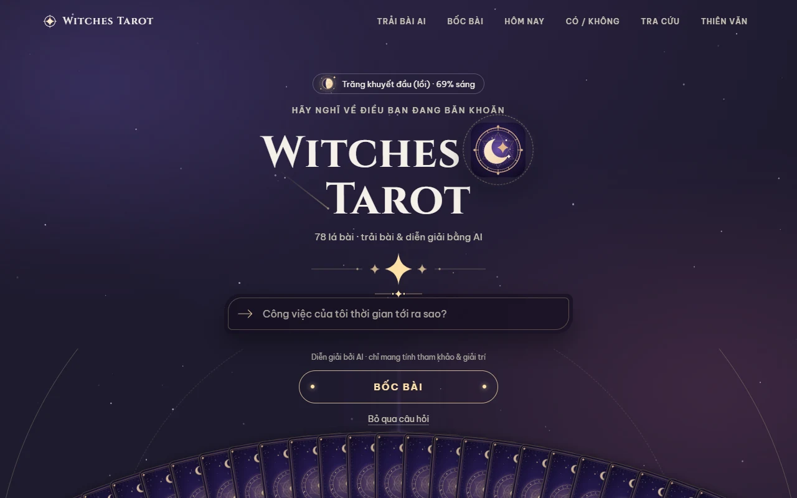
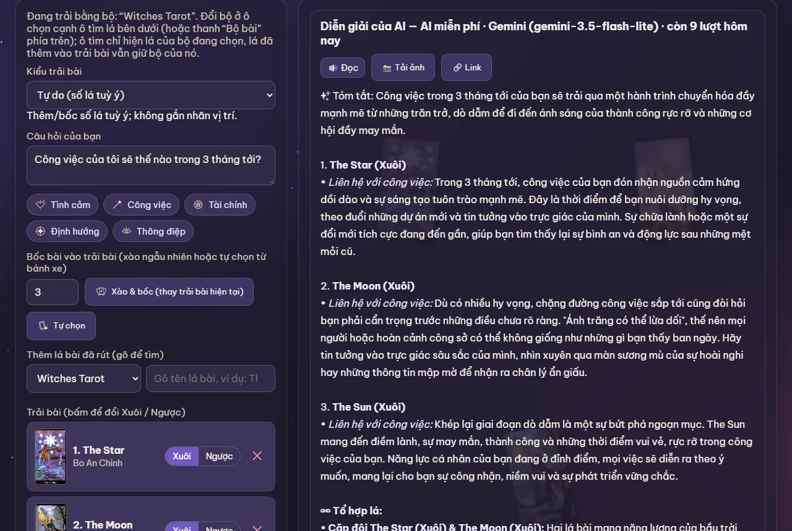
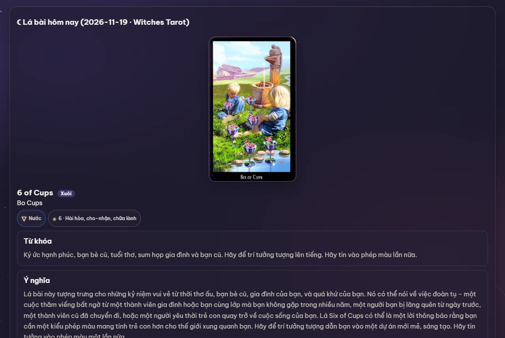

<div align="center">

<a href="https://tt-witches-tarot.vercel.app"></a>

# Witches Tarot — Free Online Tarot Reading with AI

**Ask a question, draw your cards, get an AI reading written just for you.**<br>
Look up all 78 card meanings of the **Witches Tarot** and **Rider-Waite** decks: upright, reversed, keywords, symbolism.

[Tiếng Việt](README.md) · **English**

[](https://tt-witches-tarot.vercel.app)


<a href="https://tt-witches-tarot.vercel.app"></a>

</div>

> The app's interface is available in **Vietnamese and English** (switch in *Site settings*). Card meanings are written in Vietnamese; the English UI shows English meanings for the Witches Tarot deck.

## ✨ Why Witches Tarot?

- 🔮 **AI readings tailored to your question.** The AI reads each card's meaning for its own deck, its position in the spread and its upright/reversed orientation, then writes one flowing reading: a summary, card by card, how the cards combine, and advice.
- 🆓 **Free to use, no sign-up.** Free AI readings every day. Want unlimited? Plug in your own Gemini key or run Ollama on your own machine.
- 🃏 **Two decks, two voices.** Ellen Dugan's *Witches Tarot* (art by Mark Evans) and the classic *Rider-Waite*. Each card always uses its own deck's meaning, never mixed.
- 📖 **All 78 cards explained.** Keywords, upright and reversed meanings, imagery and astrology. Rider-Waite also covers career, love, money, health and spirituality.
- 📱 **Install it like an app.** Works offline, light and fast, looks great on phone and desktop.

## 📸 Screenshots

<table>
  <tr>
    <td width="50%"><br><b>AI reading</b> · written for your question; listen to it, save it as an image, share a link</td>
    <td width="50%"><br><b>Card lookup</b> · search in Vietnamese or English (“át kiếm”, “hierophant”)</td>
  </tr>
  <tr>
    <td><br><b>Rider-Waite</b> · switch decks in one tap</td>
    <td><br><b>Card of the day</b> · one card each day to set your energy</td>
  </tr>
  <tr>
    <td colspan="2" align="center"><br><b>Sky</b> · the real sky right now: constellations, moon phase, planet positions</td>
  </tr>
</table>

<p align="center">
  
  &nbsp;&nbsp;
  
</p>

## 🌙 Features

| | |
|---|---|
| **AI reading** | 12 spreads plus a free-form spread: single card, Past · Present · Future, Relationship, Career, Two choices, New Moon, 7-card Horseshoe, 10-card Celtic Cross, 12-month Year Ahead… |
| **Draw** | Shuffle and draw at random, or pick cards yourself from the card wheel |
| **Yes / No** | A quick answer to a closed question |
| **Card of the day** | One card a day, stays the same all day |
| **Card lookup** | 78 cards × 2 decks, with a [shareable page for every card](https://tt-witches-tarot.vercel.app/la-bai/) |
| **Sky** | Live star map by location (Ho Chi Minh City, Hanoi, Da Nang, Can Tho) |
| **History** | Keep your past readings to revisit |
| **Sharing** | Share a reading by link, save it as an image, read it aloud |
| **Personalise** | Night Blue · Mystic Rose · Light themes, background music, effects, Vietnamese / English |
| **Backup** | Export / import your reading history as a JSON file |

## 🔐 Privacy

- No account needed. No email, name or raw IP address is stored.
- Your own AI key stays in your browser and is only sent to the AI provider you choose.
- Tarot and AI readings are for **reflection and entertainment only**, not a substitute for professional medical, legal or financial advice.

## 🛠️ Engineering (for code reviewers)

The app is a single-page PWA written in **React 18 + strict TypeScript** and built with **Vite**. It started as a single HTML file of almost 6,000 lines (plain HTML + CSS + JS). The React version was ported screen by screen and is **checked against the old app** by tests, so behaviour is unchanged. The legacy file is frozen at `tests/legacy/witches_tarot.legacy.html` and serves only as a reference.

| Layer | Tech |
|---|---|
| UI | Vite · React 18 · TypeScript (`strict`) · React Router · plain CSS (split by section, legacy cascade order kept) |
| State | Zustand (app store + per-screen stores for reading and draw) |
| Card data | SQLite in the browser via [sql.js](https://sql.js.org) (WebAssembly) · IndexedDB for the reading journal |
| Offline | Service Worker written in TS and generated at build time (`scripts/build-sw.mjs`); cache names are content hashes, with app and data caches kept apart |
| Backend | Vercel Functions (`api/`) · Supabase through typed RPC functions only (JSON POST body, no dynamic SQL) |
| Tests | Vitest + Testing Library (jsdom) · Playwright (real Chrome) for smoke, CSP, offline and screenshot parity |

### Layout

```
src/
  core/        pure logic, no React: drawing, spreads, SPREAD FACTS, prompt building, safe share links, Yes/No, journal
  services/    IO: sql.js (cardsDb), IndexedDB, localStorage, readings API, AI (providers, chat, sse)
  engines/     imperative, React-free code: starfield and sky-map canvases, Web Audio, wheel/shuffle/deal — start*() returns a { stop() } handle
  features/    one folder per screen: landing, daily, browse, draw, reading, yesno, sky, history, settings
  components/  shared pieces: nav, overlays, lightbox, icons, ambient music…
  app/         router, layout, main store, boot (DB load), PWA install
  i18n/        Vietnamese / English UI strings
  sw/          service worker (pure, testable routes + handlers)
shared/prompt.js   the AI system prompt — ONE source for both browser and server, tested against golden files
api/               ai.js (free AI), readings.js (saved readings), llm.js / img.js (proxies), _guard.js (shared guards)
```

### The AI part

- **Prompt building:** `src/core/prompt.ts` combines the question with each card: its position, upright or reversed, and **only** the meaning from that deck for that orientation. The system prompt comes from `shared/prompt.js`.
- **SPREAD FACTS:** `src/core/facts.ts` computes the structure of the spread in code:
  - Major Arcana ratio;
  - dominant and missing elements;
  - reversals and repeated numbers;
  - elemental dignities between adjacent cards;
  - the quintessence.

  The model gets these as ground truth and is told not to recount them, which cuts down on made-up claims.
- **Streaming with provider fallback:** `src/services/ai/chat.ts` tries the main provider first, then any other configured own-key providers (Gemini, ZenMux, Beeknoee, Ollama), then the free AI. It switches only when a provider fails **before** any text has streamed, so two answers are never spliced together.
- **Cancellation:** each open answer is a session with its own `AbortSignal` (`features/reading/interpret.ts`). Opening another answer aborts the old calls, so they never write into the new view.
- **Free endpoint `/api/ai`:**
  - The server holds the keys and builds the system prompt itself, dropping any client `system` message.
  - It checks the origin and sanitises the conversation (`cleanMessages`).
  - It tries Gemini → Ollama → OpenRouter.
  - It counts daily usage per device, per network (hashed IP) and site-wide in one Supabase transaction (`ai_usage_claim`). If every provider fails, the slot is refunded (`ai_usage_release`).

### Testing strategy

- **Legacy-parity harness** (`tests/legacy/harness.ts`): pulls functions and constants by name out of the frozen HTML, runs them in a Node `vm` sandbox and compares them with the new code. It covers drawing, spreads, SPREAD FACTS, prompts, Yes/No, sharing and more. Other tests read the frozen file directly to compare i18n strings, CSS, SVG and markup byte for byte.
- **Screenshot parity** (`scripts/parity-screens.mjs`): captures each screen on legacy and on React, with seeded `Math.random` and animations off, and reports the % of differing pixels.
- **Smoke** (`scripts/smoke-flows.mjs`): runs the main flows in real Chrome. `/api/ai` and `/api/readings` are always mocked, so no free-AI quota is spent and nothing is written.
- **CSP** (`scripts/csp-check.mjs`): serves `dist/` with the exact `vercel.json` headers and requires zero CSP violations. `script-src` has no `'unsafe-inline'`; the single inline script is allowed by hash.
- **Offline / PWA updates** (`scripts/offline-check.mjs`):
  - an installed legacy app has its old caches removed;
  - a meta-only rebuild refetches nothing;
  - a code change keeps the data cache;
  - the app still opens offline.
- **Post-deploy:** `deploy-*.mjs` checks that the live `app-version` matches the local build, then checks the app routes, the SEO pages and the API.

### Scripts

| Command | What |
|---|---|
| `npm run dev` | Vite dev server (card data served from the repo root through an allowlist) |
| `npm run check` | typecheck + lint (0 warnings) + tests — what CI runs |
| `npm run build` | Builds `dist/`, copies static data, generates the service worker (needs local card data) |
| `node scripts/smoke-flows.mjs [BASE]` | Smoke on the dev server, or on an existing `BASE` |
| `node scripts/csp-check.mjs` · `node scripts/offline-check.mjs` | CSP / offline checks on `dist/` |
| `node scripts/parity-screens.mjs [screen]` | Legacy ↔ React screenshot diff |
| `node scripts/deploy-preview.mjs` · `node scripts/deploy-prod.mjs` | Local prebuilt deploy to Vercel Preview / Production (prod only from `main`) |

**Card data is private and not in this repository** (`tarot.db`, `card_en.json`, `la-bai/`, `Data/*`). For that reason CI runs only `npm run check`, while build and deploy happen locally: `vercel build`, then `vercel deploy --prebuilt`. Operations notes (AI keys, Supabase, anti-spam, CSP; in Vietnamese): **[docs/DEVELOPMENT.md](docs/DEVELOPMENT.md)**.

## 🙏 Credits

Card artwork belongs to the authors and publishers of each deck: *Witches Tarot* by Ellen Dugan and Mark Evans (Llewellyn), *Rider-Waite* by Pamela Colman Smith and A. E. Waite. Meaning texts are adapted from [tarot.vn](https://tarot.vn). A non-commercial project for learning and reference.
