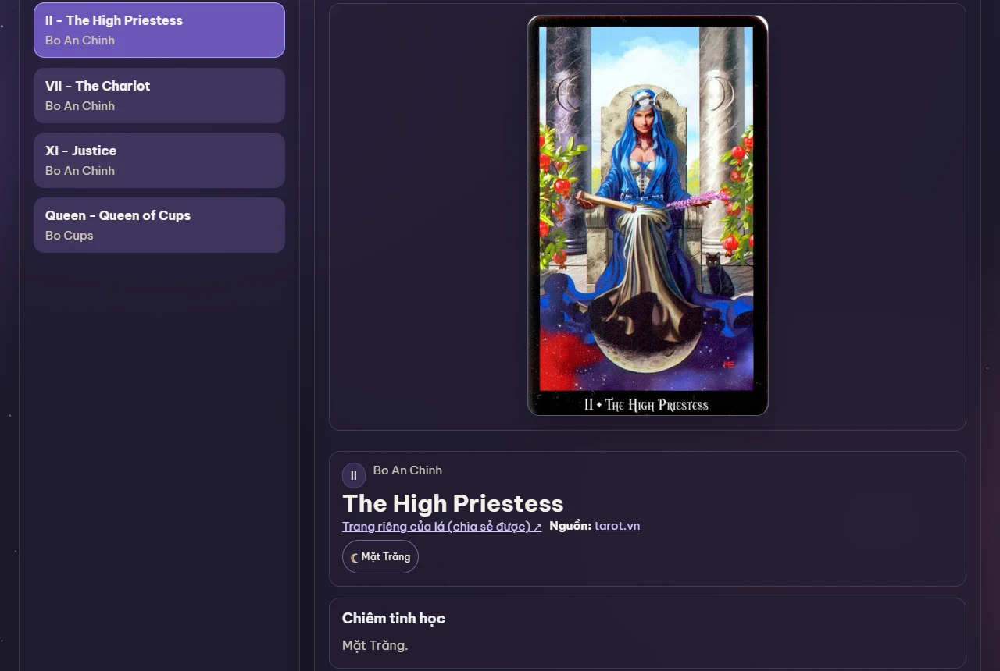
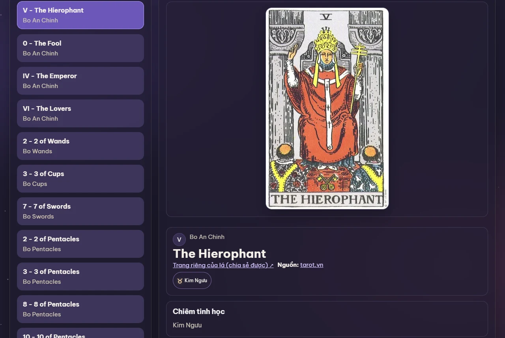
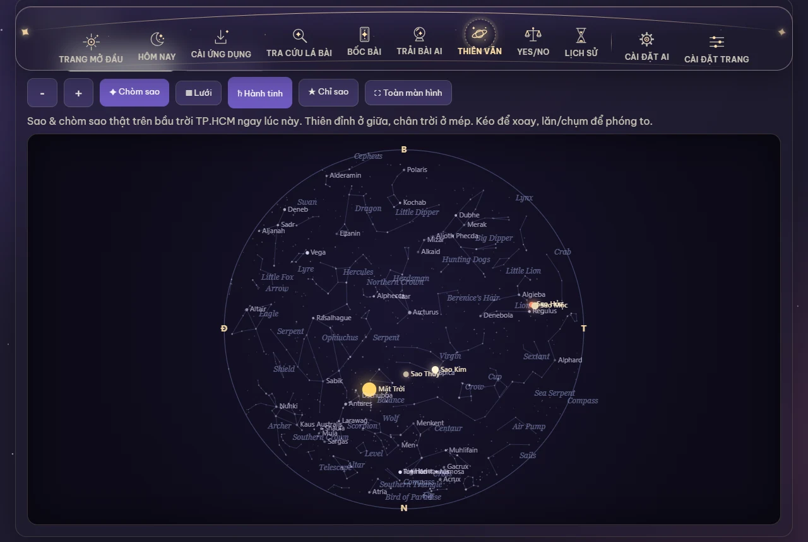
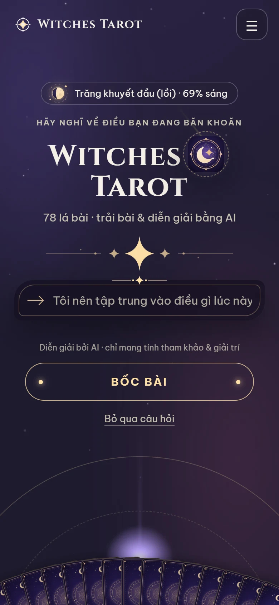
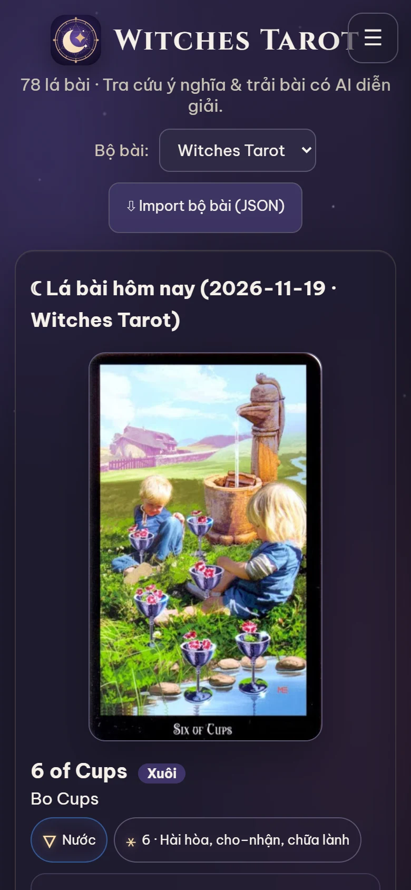

# Witches Tarot — Free Online Tarot Reading with AI

**Ask a question, draw your cards, get an AI reading written just for you.** 
Look up all 78 card meanings of the **Witches Tarot** and **Rider-Waite** decks: upright, reversed, keywords, symbolism.

[Tiếng Việt](README.md) · **English**

> The app's interface is available in **Vietnamese and English** (switch in *Site settings*). Card meanings are written in Vietnamese; the English UI shows English meanings for the Witches Tarot deck.

## ✨ Why Witches Tarot?

- 🔮 **AI readings tailored to your question.** The AI reads each card's meaning for its own deck, its position in the spread and its upright/reversed orientation, then writes one flowing reading: a summary, card by card, how the cards combine, and advice.
- 🆓 **Free to use, no sign-up.** Free AI readings every day. Want unlimited? Plug in your own Gemini key or run Ollama on your own machine.
- 🃏 **Two decks, two voices.** Ellen Dugan's *Witches Tarot* (art by Mark Evans) and the classic *Rider-Waite*. Each card always uses its own deck's meaning, never mixed.
- 📖 **All 78 cards explained.** Keywords, upright and reversed meanings, imagery and astrology. Rider-Waite also covers career, love, money, health and spirituality.
- 📱 **Install it like an app.** Works offline, light and fast, looks great on phone and desktop.

## 📸 Screenshots

<table>
  <tr>
    <td width="50%"> <b>AI reading</b> · written for your question; listen to it, save it as an image, share a link</td>
    <td width="50%"> <b>Card lookup</b> · search in Vietnamese or English (“át kiếm”, “hierophant”)</td>
  </tr>
  <tr>
    <td> <b>Rider-Waite</b> · switch decks in one tap</td>
    <td> <b>Card of the day</b> · one card each day to set your energy</td>
  </tr>
  <tr>
    <td colspan="2" align="center"> <b>Sky</b> · the real sky right now: constellations, moon phase, planet positions</td>
  </tr>
</table>

  
  &nbsp;&nbsp;
  

## 🌙 Features

| | |
|---|---|
| **AI reading** | 12 spreads plus a free-form spread: single card, Past · Present · Future, Relationship, Career, Two choices, New Moon, 7-card Horseshoe, 10-card Celtic Cross, 12-month Year Ahead… |
| **Draw** | Shuffle and draw at random, or pick cards yourself from the card wheel |
| **Yes / No** | A quick answer to a closed question |
| **Card of the day** | One card a day, stays the same all day |
| **Card lookup** | 78 cards × 2 decks, with a [shareable page for every card](https://tt-witches-tarot.vercel.app/la-bai/) |
| **Sky** | Live star map by location (Ho Chi Minh City, Hanoi, Da Nang, Can Tho) |
| **History** | Keep your past readings to revisit |
| **Sharing** | Share a reading by link, save it as an image, read it aloud |
| **Personalise** | Night Blue · Mystic Rose · Light themes, background music, effects, Vietnamese / English |
| **Your own deck** | Import extra decks from a JSON file |

## 🔐 Privacy

- No account needed. No email, name or raw IP address is stored.
- Your own AI key stays in your browser and is only sent to the AI provider you choose.
- Tarot and AI readings are for **reflection and entertainment only**, not a substitute for professional medical, legal or financial advice.

## 🛠️ Tech

A single HTML file (plain HTML + CSS + JS) · card data in SQLite running in the browser via [sql.js](https://sql.js.org) · Service Worker for offline use · serverless API on [Vercel](https://vercel.com) · Supabase for AI quotas and saved readings · AI: Gemini → Ollama → OpenRouter, failing over automatically when a provider runs out.

Card data (meanings, images) is not included in this repository. Deploy, AI keys, Supabase, anti-spam/DDoS and CSP notes (in Vietnamese): **[docs/DEVELOPMENT.md](docs/DEVELOPMENT.md)**.

## 🙏 Credits

Card artwork belongs to the authors and publishers of each deck: *Witches Tarot* by Ellen Dugan and Mark Evans (Llewellyn), *Rider-Waite* by Pamela Colman Smith and A. E. Waite. Meaning texts are adapted from [tarot.vn](https://tarot.vn). A non-commercial project for learning and reference.
