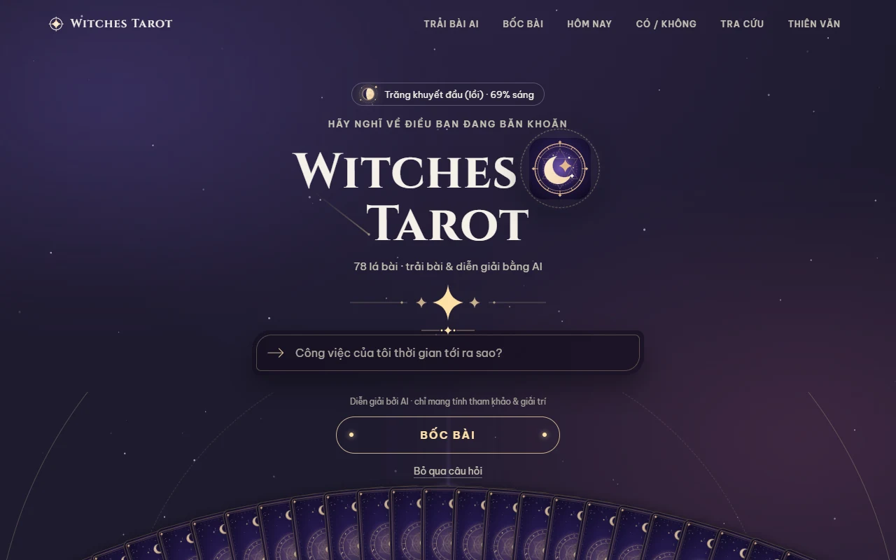
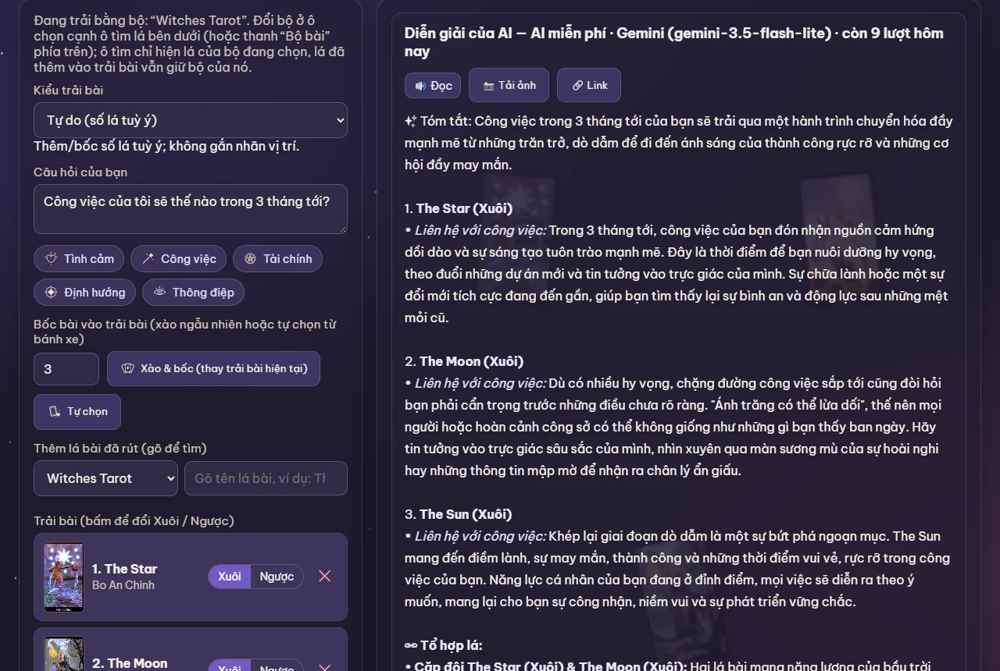
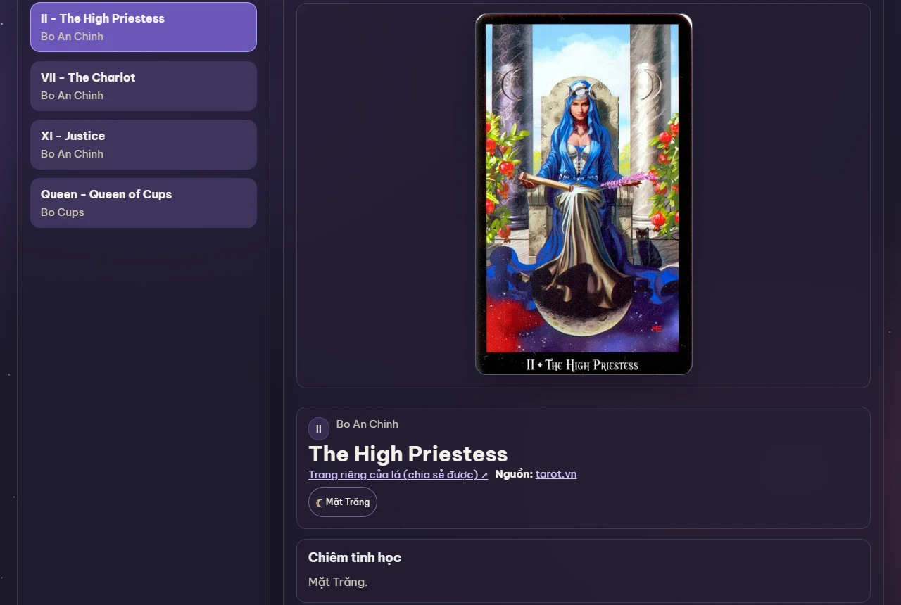
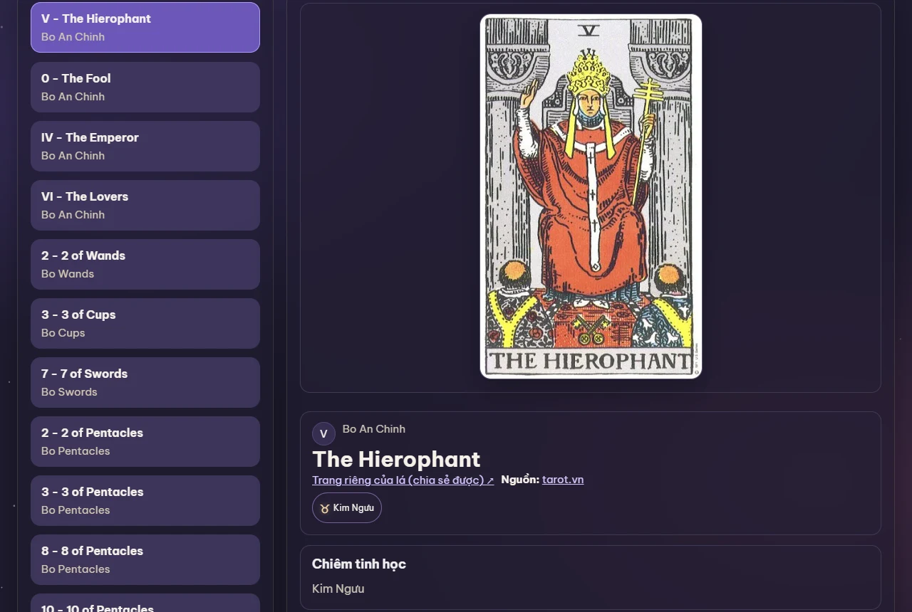
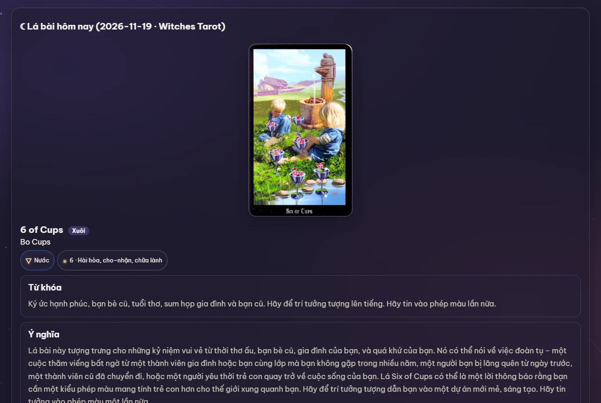
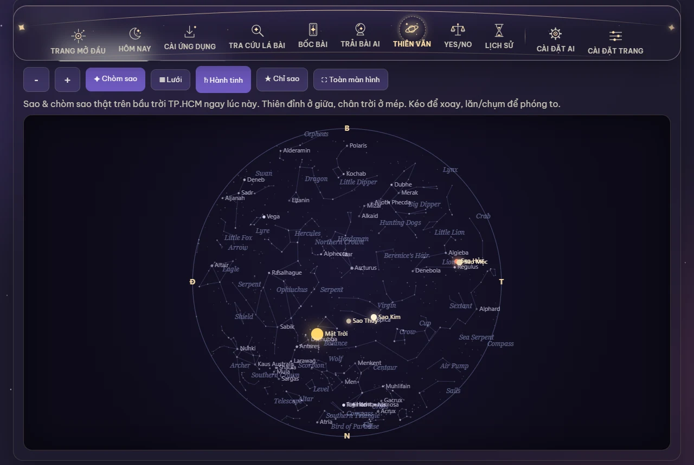
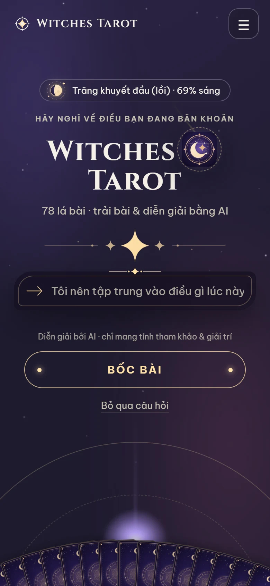
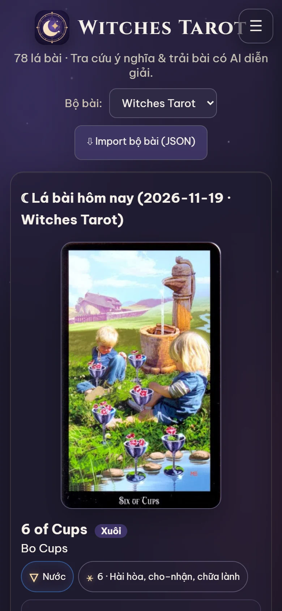

<div align="center">

<a href="https://tt-witches-tarot.vercel.app"></a>

# Witches Tarot — Trải bài Tarot online, diễn giải bằng AI

**Đặt câu hỏi, bốc bài, nhận lời giải AI viết riêng cho bạn.**<br>
Tra cứu ý nghĩa 78 lá bài **Witches Tarot** và **Rider-Waite**: xuôi, ngược, từ khóa, biểu tượng.

**Tiếng Việt** · [English](README.en.md)

[](https://tt-witches-tarot.vercel.app)


<a href="https://tt-witches-tarot.vercel.app"></a>

</div>

## ✨ Vì sao chọn Witches Tarot?

- 🔮 **AI diễn giải theo đúng câu hỏi của bạn.** AI đọc ý nghĩa từng lá theo đúng bộ bài, vị trí trong trải bài và chiều xuôi/ngược, rồi viết lời giải liền mạch: tóm tắt, từng lá, các cặp lá kết hợp và lời khuyên.
- 🆓 **Dùng ngay, không cần đăng ký.** Mỗi ngày có sẵn lượt AI miễn phí. Muốn dùng không giới hạn thì gắn key Gemini của riêng bạn hoặc chạy Ollama ngay trên máy.
- 🃏 **Hai bộ bài, mỗi bộ một giọng.** *Witches Tarot* của Ellen Dugan (minh họa Mark Evans) và *Rider-Waite* kinh điển. Nghĩa của lá nào lấy theo đúng bộ đó, không trộn lẫn.
- 📖 **Tra cứu đầy đủ 78 lá.** Từ khóa, nghĩa xuôi, nghĩa ngược, mô tả hình ảnh và chiêm tinh. Rider-Waite có thêm nghĩa riêng cho công việc, tình yêu, tài chính, sức khỏe và tinh thần.
- 📱 **Cài như một app.** Mở được khi không có mạng, nhẹ, nhanh, đẹp trên cả điện thoại lẫn máy tính.

## 📸 Ảnh chụp

<table>
  <tr>
    <td width="50%"><br><b>Trải bài AI</b> · lời giải viết riêng cho câu hỏi, đọc to hoặc tải ảnh, chia sẻ bằng link</td>
    <td width="50%"><br><b>Tra cứu lá bài</b> · tìm được bằng tiếng Việt hoặc tiếng Anh (“át kiếm”, “hierophant”)</td>
  </tr>
  <tr>
    <td><br><b>Rider-Waite</b> · đổi bộ bài bằng một cú chạm</td>
    <td><br><b>Lá bài hôm nay</b> · một lá mỗi ngày để định hướng năng lượng</td>
  </tr>
  <tr>
    <td colspan="2" align="center"><br><b>Thiên văn</b> · bầu trời thật lúc này: chòm sao, pha Mặt Trăng, vị trí các hành tinh</td>
  </tr>
</table>

<p align="center">
  
  &nbsp;&nbsp;
  
</p>

## 🌙 Tính năng

| | |
|---|---|
| **Trải bài AI** | 12 kiểu trải bài và trải tự do: 1 lá, Quá khứ · Hiện tại · Tương lai, Mối quan hệ, Công việc & sự nghiệp, Hai lựa chọn, Trăng mới, Móng ngựa 7 lá, Celtic Cross 10 lá, Năm tới 12 tháng… |
| **Bốc bài** | Xào và bốc ngẫu nhiên, hoặc tự chọn lá trên bánh xe bài |
| **Có / Không** | Câu trả lời nhanh cho câu hỏi đóng |
| **Lá bài hôm nay** | Mỗi ngày một lá, giữ nguyên cả ngày |
| **Tra cứu** | 78 lá × 2 bộ, có [trang riêng cho từng lá](https://tt-witches-tarot.vercel.app/la-bai/) để chia sẻ |
| **Thiên văn** | Bầu trời sao theo vị trí (TP.HCM, Hà Nội, Đà Nẵng, Cần Thơ) |
| **Lịch sử** | Lưu lại các lần trải bài để xem lại |
| **Chia sẻ** | Gửi trải bài qua link, tải lời giải thành ảnh, nghe đọc to |
| **Tuỳ biến** | Giao diện Xanh đêm · Hồng huyền · Sáng, nhạc nền, hiệu ứng, tiếng Việt / English |
| **Sao lưu** | Xuất / nhập lịch sử trải bài thành file JSON |

## 🔐 Riêng tư

- Không cần tài khoản. Không lưu email, tên hay IP thô.
- Key AI của riêng bạn chỉ nằm trong trình duyệt và chỉ gửi tới nhà cung cấp AI bạn chọn.
- Tarot và lời diễn giải của AI chỉ mang tính **tham khảo, gợi mở và giải trí**, không thay thế lời khuyên chuyên môn về sức khỏe, pháp lý hay tài chính.

## 🛠️ Kỹ thuật (dành cho người đọc code)

App là PWA một trang viết bằng **React 18 + TypeScript strict**, build bằng **Vite**. Trước đây toàn bộ app nằm trong một file HTML gần 6.000 dòng (HTML + CSS + JS thuần); bản React được port lại từng màn và **so khớp với bản cũ** bằng test, nên hành vi giữ nguyên — trừ tab **Bốc bài**, được thiết kế lại có chủ đích theo yêu cầu của chủ dự án (dùng chung ô chọn kiểu trải, bàn trải và hiệu ứng chia lá với Trải bài AI, tự cuộn, tên nút rõ nghĩa; xem spec §5.8 trong `docs/superpowers/specs/2026-11-19-react-migration-design.md`). Bản cũ đóng băng ở `tests/legacy/witches_tarot.legacy.html`, chỉ dùng làm tham chiếu.

| Lớp | Công nghệ |
|---|---|
| Giao diện | Vite · React 18 · TypeScript (`strict`) · React Router · CSS thuần (tách theo phần, giữ nguyên thứ tự của bản cũ) |
| Trạng thái | Zustand (store app + store riêng của từng màn: trải bài, bốc bài) |
| Dữ liệu bài | SQLite chạy ngay trên trình duyệt bằng [sql.js](https://sql.js.org) (WebAssembly) · IndexedDB cho nhật ký trải bài |
| Offline | Service Worker viết bằng TS, sinh lúc build (`scripts/build-sw.mjs`): tên cache là hash nội dung, cache app và cache dữ liệu tách riêng |
| Backend | Vercel Functions (`api/`) · Supabase chỉ qua hàm RPC có kiểu (POST body JSON, không SQL động) |
| Test | Vitest + Testing Library (jsdom) · Playwright (Chrome thật) cho smoke, CSP, offline và so ảnh chụp |

### Cấu trúc

```
src/
  core/        logic thuần, không React: bốc bài, kiểu trải, SPREAD FACTS, dựng prompt, chia sẻ an toàn, Yes/No, nhật ký
  services/    IO: sql.js (cardsDb), IndexedDB, localStorage, API lưu trải bài, AI (providers, chat, sse)
  engines/     mã mệnh lệnh không React: canvas nền sao, bản đồ sao, Web Audio, bánh xe/xào/chia bài — start*() trả về handle { stop() }
  features/    từng màn: landing, daily, browse, draw, reading, yesno, sky, history, settings
  components/  phần dùng chung: menu, overlay, lightbox, biểu tượng, nhạc nền…
  app/         router, layout, store chính, khởi động (nạp DB), cài PWA
  i18n/        chữ giao diện Việt / English
  sw/          service worker (routes + handlers thuần, test được)
shared/prompt.js   system prompt AI — MỘT nguồn duy nhất cho cả trình duyệt và server, test so với golden
api/               ai.js (AI miễn phí), readings.js (lưu trải bài), llm.js / img.js (proxy), _guard.js (hàng rào chung)
```

### Phần AI

- **Dựng prompt:** `src/core/prompt.ts` ghép câu hỏi + từng lá (vị trí, xuôi/ngược, **chỉ** ý nghĩa của đúng bộ bài và đúng chiều). System prompt lấy từ `shared/prompt.js`.
- **SPREAD FACTS:** `src/core/facts.ts` tính bằng code các dữ kiện của trải bài: tỉ lệ Ẩn Chính, nguyên tố trội/thiếu, số lá ngược, số lặp lại, tương tác nguyên tố giữa các lá kề nhau, quintessence. AI nhận chúng làm căn cứ và được dặn không tự đếm lại. Cách này giảm chuyện AI "bịa".
- **Streaming + tự chuyển provider:** `src/services/ai/chat.ts` thử lần lượt provider chính, các key riêng đã cấu hình (Gemini, ZenMux, Beeknoee, Ollama), rồi AI miễn phí. Chỉ chuyển khi provider lỗi **trước** khi stream được chữ nào, để không ghép hai câu trả lời.
- **Huỷ đúng lúc:** mỗi lời giải đang mở là một phiên có `AbortSignal` riêng (`features/reading/interpret.ts`). Mở lời giải khác thì lượt gọi cũ bị huỷ và không ghi đè giao diện mới.
- **AI miễn phí `/api/ai`:**
  - server giữ key và tự dựng system prompt (bỏ tin `system` của client);
  - kiểm tra origin và lọc hội thoại (`cleanMessages`);
  - thử Gemini → Ollama → OpenRouter;
  - đếm lượt/ngày theo thiết bị, theo mạng (IP đã băm) và toàn site, trong một giao dịch Supabase (`ai_usage_claim`). Nếu mọi provider đều lỗi thì hoàn lượt (`ai_usage_release`).

### Chiến lược test

- **Harness so với bản cũ** (`tests/legacy/harness.ts`): lấy hàm/hằng theo tên từ bản HTML đóng băng, chạy trong sandbox Node (`vm`) và so kết quả với code mới (bốc bài, kiểu trải, SPREAD FACTS, prompt, Yes/No, chia sẻ…). Các test khác đọc thẳng bản đóng băng để so chữ i18n, CSS, SVG và markup từng byte.
- **So ảnh chụp** (`scripts/parity-screens.mjs`): chụp từng màn trên bản cũ và bản React (Math.random cố định, tắt animation), rồi in % điểm ảnh khác nhau.
- **Smoke** (`scripts/smoke-flows.mjs`): chạy các luồng chính trên Chrome thật. `/api/ai` và `/api/readings` luôn được giả lập, nên không tốn lượt AI và không ghi dữ liệu.
- **CSP** (`scripts/csp-check.mjs`): phục vụ `dist/` với đúng header của `vercel.json`. Yêu cầu không có vi phạm CSP nào; `script-src` không có `'unsafe-inline'`, script inline duy nhất được cho phép bằng hash.
- **Offline / cập nhật PWA** (`scripts/offline-check.mjs`):
  - có sẵn cache tên `wtarot-v9` (giả lập): bị xoá;
  - bản build chỉ đổi thẻ meta: không tải lại gì;
  - bản build đổi code: giữ cache dữ liệu;
  - mất mạng: app vẫn mở.
- **Nâng cấp từ bản cũ** (`scripts/upgrade-check.mjs`, Chrome thật, chỉ `127.0.0.1`): chạy bản cũ đóng băng **cùng `sw.js` cũ** trên cổng P, tạo dữ liệu bằng chính code cũ (một lượt trải bài trong IndexedDB `witchesTarotDecks`, theme / mặt lưng / ngôn ngữ qua control cũ, ghi chú hôm nay, `tarotDeviceId`, cache `wtarot-v9` do SW cũ điền), rồi phục vụ `dist/` trên **cùng cổng P** (cùng origin) và tải lại. Script khẳng định:
  - SW mới điều khiển trang (`controllerchange`), chỉ còn cache `wtarot-app-*` + `wtarot-data-*`;
  - `/nhat-ky` có lượt trải bài cũ, theme / mặt lưng / ngôn ngữ được áp, `/hom-nay` hiện ghi chú cũ, `tarotDeviceId` không đổi;
  - 3 link chia sẻ `#r=` tạo bằng bản cũ (ppf có lá ngược, Celtic Cross, Tự do 5 lá) mở trên bản mới đúng câu hỏi, kiểu trải, số lá, chiều xuôi/ngược, tên lá và lời giải;
  - sau đó tắt máy chủ, mất mạng: `/tra-cuu` liệt kê lá, `/boc-bai` xòe được bài.
  Không kiểm tra: nâng cấp từ bản cũ hơn `wtarot-v9`, ghi chú hỏi-tiếp/ghi chú lượt, Safari/Firefox.
- **Sau deploy:** `deploy-*.mjs` kiểm tra `app-version` trên trang thật phải khớp với bản build ở máy, kiểm tra các route, trang SEO và API.

### Lệnh

| Lệnh | Việc |
|---|---|
| `npm run dev` | Dev server Vite (dữ liệu bài phục vụ từ gốc repo theo danh sách trắng) |
| `npm run check` | typecheck + lint (0 cảnh báo) + test — CI chạy lệnh này |
| `npm run build` | Build `dist/` + chép dữ liệu tĩnh + sinh service worker (cần dữ liệu bài ở máy) |
| `node scripts/smoke-flows.mjs [BASE]` | Smoke trên dev server, hoặc trên `BASE` có sẵn |
| `node scripts/csp-check.mjs` · `node scripts/offline-check.mjs` | Kiểm tra CSP / offline trên `dist/` |
| `node scripts/upgrade-check.mjs` | Nâng cấp thật bản cũ → bản React trên cùng origin + link chia sẻ cũ (cần `dist/`) |
| `node scripts/parity-screens.mjs [màn]` | So ảnh bản cũ ↔ bản React |
| `node scripts/deploy-preview.mjs` · `node scripts/deploy-prod.mjs` | Deploy prebuilt từ máy lên Vercel Preview / Production (prod chỉ từ `main`) |

**Dữ liệu bài là riêng tư, không có trong repo** (`tarot.db`, `card_en.json`, `la-bai/`, `Data/*`). Vì vậy CI chỉ chạy `npm run check`, còn build và deploy chạy ở máy: `vercel build` rồi `vercel deploy --prebuilt`. Hướng dẫn vận hành (key AI, Supabase, chống spam, CSP): **[docs/DEVELOPMENT.md](docs/DEVELOPMENT.md)**.

## 🙏 Ghi công

Hình lá bài thuộc bản quyền của tác giả và nhà xuất bản từng bộ: *Witches Tarot* của Ellen Dugan và Mark Evans (Llewellyn), *Rider-Waite* của Pamela Colman Smith và A. E. Waite. Nội dung ý nghĩa tham khảo từ [tarot.vn](https://tarot.vn). Dự án phi thương mại, dùng cho mục đích học tập và tham khảo.
